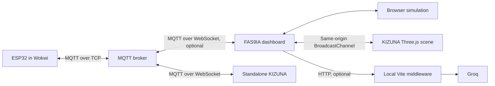

# MIZUNIA · FAS9IA

FAS9IA is an operator dashboard for a **simulated water-resilience pilot in Borj Râs, Mahdia, Tunisia**. It demonstrates how shared rainwater cisterns (فاسقيات) could support non-potable water needs during a supply interruption. Municipal operators can explore reserve availability, backup distribution, and incident response alongside the KIZUNA hydraulic simulation.

## Choose a branch

| Branch | Use it for |
| --- | --- |
| `main` | Project overview and setup guide. |
| [`feat/fas9ia-dashboard`](https://github.com/hamzafhaiel/MIZUNIA/tree/feat/fas9ia-dashboard) | Integrated React dashboard, browser-based KIZUNA simulation, and optional ESP32 and Groq connections. [Dashboard guide](https://github.com/hamzafhaiel/MIZUNIA/blob/feat/fas9ia-dashboard/README.md) |
| [`prototype1`](https://github.com/hamzafhaiel/MIZUNIA/tree/prototype1) | Standalone KIZUNA prototype with the ESP32 firmware, Wokwi circuit, MQTT client, and Three.js scene. [Prototype guide](https://github.com/hamzafhaiel/MIZUNIA/blob/prototype1/README.md) |

Use `prototype1` when working on the standalone prototype. The similarly named `prototype` branch contains the initial README.

## Implemented features

- **Opérations and Réserves.** Find cisterns on the Borj Râs map, register a cistern and sensor ID, submit a simulated reading, and review usable stock and autonomy estimates. Cisterns without a reading are excluded from measured storage.
- **KIZUNA simulation.** Open the 3D scene from the dashboard and synchronize the browser simulation across tabs. Simulate rain, irrigation, a noon SONEDE outage, and non-potable backup distribution to three demonstration sectors.
- **Vannes and Énergie.** Inspect simulated flows, adjust valves, and track solar output, pump load, generator fuel, and backup power. The proportional valves and generator controls are available in local simulation mode.
- **Incidents and maintenance.** Review simulated leakage, sensor failures, and thermal alerts. Copy or download a leak report or open an email draft. Test annual cleaning (*tandifa*) and settling after a deposit.
- **Optional assistance.** Groq can select a simulated operating profile or source basin and suggest reserve display hints. The simulation applies hydraulic calculations and operating limits locally. Rule-based behavior is available without Groq.

## Architecture



In **KIZUNA · Simulation locale**, the dashboard and its linked KIZUNA scene share simulated state and commands. In **KIZUNA · ESP32 Wokwi**, the dashboard can exchange telemetry and supported commands with the simulated firmware. The client requires a fresh reading before sending a command and waits for the matching acknowledgement. See the versioned [MQTT contract](https://github.com/hamzafhaiel/MIZUNIA/blob/prototype1/MQTT.md) for topics and payloads.

The dashboard lockfile pins React **19.3.1**, TypeScript **5.9.3**, Vite **7.3.8**, Three.js **0.187.0**, React Three Fiber **9.8.2**, and MQTT.js **5.16.1**. The standalone prototype uses JavaScript, Vite **8.3.8**, Three.js **0.187.0**, and MQTT.js **5.16.1**. The firmware builds for PlatformIO's `esp32dev` board with Arduino and Espressif32 **6.12.0**.

## Run the dashboard

Use **Git, Node.js 22.12 or newer, npm, and a WebGL-capable browser**.

```sh
git clone --branch feat/fas9ia-dashboard https://github.com/hamzafhaiel/MIZUNIA.git mizunia-dashboard
cd mizunia-dashboard
npm ci
npm run dev
```

1. Open the URL printed by Vite. Use **Skip intro** or **Esc** to reach the demo sign-in.
2. Sign in with the public demo account `demo@fas9ia.test` and password `Fas9ia-Demo2026!`. This is a browser-side demo sign-in.
3. Open **Simulation**, select **KIZUNA · Simulation locale**, and click **Ouvrir la simulation 3D**. Keep both tabs open. Try rainfall or **Simuler la coupure de 12 h** to see the backup distribution scenario.

## Run the standalone prototype

```sh
git clone --branch prototype1 https://github.com/hamzafhaiel/MIZUNIA.git mizunia-prototype
cd mizunia-prototype
npm ci
npm run dev
```

Open the URL printed by Vite and enable **Aperçu 3D avec niveaux fictifs** for a browser-only demo. To use the simulated ESP32, open the project in VS Code with the PlatformIO IDE and Wokwi Simulator extensions. Run `pio run` in a PlatformIO terminal and choose **Wokwi: Start Simulator**. The dashboard branch also includes a firmware copy in `kizuna-prototype/`. [Wokwi setup in the prototype guide](https://github.com/hamzafhaiel/MIZUNIA/blob/prototype1/README.md)

## Configuration

Add optional settings to `.env.local` beside the relevant app's `package.json`. Restart Vite after changes. Keep the Groq key server-side and use fictional telemetry on the public MQTT demo broker.

| Variable | Required | Default | Description |
| --- | --- | --- | --- |
| `VITE_KIZUNA_MQTT_URL` | For dashboard Wokwi mode | Unset | MQTT broker WebSocket URL. The supplied firmware defaults to the broker reachable at `wss://test.mosquitto.org:8081/mqtt` from the browser. |
| `VITE_KIZUNA_MQTT_PREFIX` | For dashboard Wokwi mode | Unset | Topic prefix matching `TopicPrefix` in the firmware configuration. |
| `GROQ_API_KEY` | For Groq assistance | Unset | Server-side key loaded by the dashboard's Vite middleware. |
| `GROQ_MODEL` | No | `openai/gpt-oss-20b` | Model used when Groq assistance is enabled. |
| `VITE_MQTT_URL` | No, standalone prototype | `wss://test.mosquitto.org:8081/mqtt` | Broker WebSocket URL. |
| `VITE_MQTT_PREFIX` | No, standalone prototype | `kizuna/mahdia/demo-7c42e9/bassin-1` | Default demo topic prefix. Use a distinct prefix for your team and match it in the firmware and clients. |

The ESP32 uses `BrokerHost`, `BrokerPort`, and `TopicPrefix` in `firmware/config.h`. Rebuild the firmware after changing them. Groq assistance is available on the dashboard's loopback Vite dev and preview servers. Static hosting of `dist/` serves the frontend and simulation.

## Development and testing

| Task | Dashboard branch | Standalone prototype |
| --- | --- | --- |
| Local development | `npm run dev` | `npm run dev` |
| Unit tests | `npm test` | — |
| Build web app | `npm run build` | `npm run build` |
| Preview web build | `npm run preview` | `npm run preview` |
| Build Wokwi firmware | `pio run` from `kizuna-prototype/` | `pio run` from the branch root |

The dashboard build checks TypeScript before bundling. The dashboard tests cover cistern readings, histories, park incidents, valves, and KIZUNA behavior.

## Project structure

```text
feat/fas9ia-dashboard/
├── src/
│   ├── main.tsx             Dashboard routes and app state
│   ├── kizuna-pilot.ts      Backup distribution and operating constraints
│   ├── kizuna-connection.ts  MQTT telemetry and command acknowledgements
│   ├── kizuna/              Dashboard-to-scene bridge
│   └── twin/                Parc Hydraulique model and telemetry
├── kizuna/index.html        Dashboard-linked KIZUNA scene entry point
├── kizuna-prototype/        Shared 3D scene, Wokwi circuit, and firmware
├── public/                  Map and visual assets
└── vite.config.mjs          Web entry points and local Groq middleware

prototype1/
├── src/                     Standalone 3D simulation and MQTT client
├── firmware/                ESP32 firmware and broker defaults
├── diagram.json             Wokwi circuit
├── platformio.ini           Firmware build configuration
├── wokwi.toml               Wokwi firmware paths
└── MQTT.md                  Telemetry and command format
```

## Pilot scope

The map uses [OpenStreetMap data](https://www.openstreetmap.org/copyright). The monitored cistern placements, supply interruptions, and pump operations are demonstration scenarios. The dashboard stores its cistern registry, incident journal, and maintenance calendar in the browser. A field pilot would require a site inventory, an operating partner, and water-quality validation for the intended non-potable uses.

[TODO: Add the deployed demo URL once it has been verified.]

## Contributing and license

For dashboard changes, branch from `feat/fas9ia-dashboard` and run `npm test` and `npm run build` before opening a pull request. For standalone prototype changes, branch from `prototype1` and run `npm run build`. Run `pio run` for firmware changes and document any modified MQTT topics or payloads.

[TODO: Confirm the source-code license and add a LICENSE file.]
