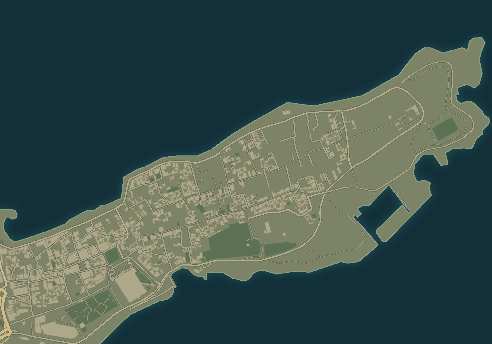
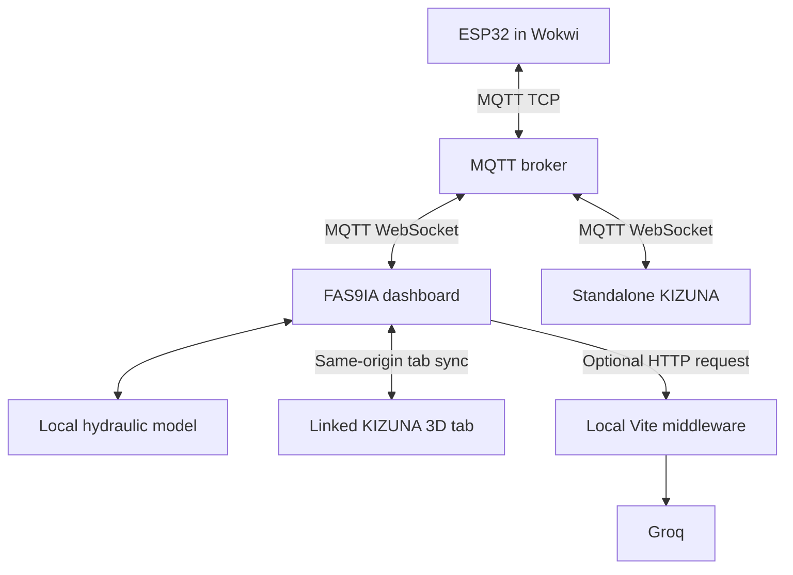

<a name="readme-top"></a>

<div align="center">
  <h1>MIZUNIA · FAS9IA</h1>
  <p>A municipal dashboard and hydraulic simulator for managing shared rainwater reserves during water cuts.</p>
  <p>Borj Râs · Mahdia, Tunisia</p>
  <p>
    <a href="https://github.com/hamzafhaiel/MIZUNIA/commits/feat/fas9ia-dashboard/"></a>
    <a href="https://github.com/hamzafhaiel/MIZUNIA/stargazers"></a>
    <a href="https://github.com/hamzafhaiel/MIZUNIA/blob/feat/fas9ia-dashboard/package.json"></a>
  </p>
  <p>
    <a href="#features">Features</a> ·
    <a href="#architecture">Architecture</a> ·
    <a href="#quickstart">Quickstart</a> ·
    <a href="#configuration">Configuration</a> ·
    <a href="#roadmap">Roadmap</a>
  </p>
  
  <p><sub>Illustration from the FAS9IA intro</sub></p>
</div>

## Overview and preview

FAS9IA explores how a municipality could use shared cisterns (فاسقيات) as a local non-potable reserve during a supply interruption. The dashboard shows how much water is available and helps operators rehearse backup distribution, incident response, and maintenance using the KIZUNA simulator.

<details>
<summary><b>Preview the Borj Râs map</b></summary>



Map data © [OpenStreetMap contributors](https://www.openstreetmap.org/copyright).

</details>

[TODO: Add an up-to-date screenshot of the operator dashboard and a short KIZUNA demo recording.]

[TODO: Add a verified public demo URL.]

## Features

<table>
  <tr>
    <th align="left">Operations and reserves</th>
    <th align="left">KIZUNA simulation</th>
  </tr>
  <tr>
    <td>Map and register cisterns, assign sensor IDs, enter simulated readings, and review usable stock and autonomy estimates.</td>
    <td>Rehearse rainfall, irrigation, a noon SONEDE outage, and backup distribution to three demonstration sectors. The linked 3D scene synchronizes across browser tabs.</td>
  </tr>
  <tr>
    <th align="left">Valves and energy</th>
    <th align="left">Incidents and maintenance</th>
  </tr>
  <tr>
    <td>In local simulation, adjust valve openings and track flow, solar output, pump demand, generator fuel, and backup power.</td>
    <td>Review simulated leaks, sensor faults, and thermal alerts. Download leak reports, prepare email drafts, and rehearse annual cleaning (tandifa) and settling after a deposit.</td>
  </tr>
</table>

## Architecture



1. **Local simulation.** The browser runs the hydraulic model. The dashboard and its linked Three.js tab exchange state and supported actions over `BroadcastChannel`.
2. **Wokwi mode.** The ESP32 simulator exchanges telemetry and commands through MQTT. The dashboard requires a fresh reading before sending a command and waits for its matching acknowledgement. [MQTT message contract](https://github.com/hamzafhaiel/MIZUNIA/blob/prototype1/MQTT.md)
3. **Optional Groq assistance.** Loopback Vite middleware requests a simulated operating profile, backup basin, or reserve display hints. The browser applies hydraulic calculations and protection rules and has a local fallback.

## Tech stack

| Layer | Versions and tools |
| --- | --- |
| Dashboard | React **19.3.1**, TypeScript **5.9.3**, Vite **7.3.8** |
| 3D views | Three.js **0.187.0**, React Three Fiber **9.8.2** for Parc Hydraulique |
| Standalone KIZUNA | JavaScript, Vite **8.3.8**, Three.js **0.187.0** |
| Telemetry | MQTT.js **5.16.1**, MQTT 3.1.1 |
| Firmware | C++ and Arduino on PlatformIO `esp32dev`, Espressif32 **6.12.0**, Wokwi |

Web versions above come from the committed lockfiles.

## Quickstart

| Branch | Contents |
| --- | --- |
| `main` | This overview |
| [`feat/fas9ia-dashboard`](https://github.com/hamzafhaiel/MIZUNIA/tree/feat/fas9ia-dashboard) | Dashboard, linked KIZUNA scene, and bundled Wokwi prototype |
| [`prototype1`](https://github.com/hamzafhaiel/MIZUNIA/tree/prototype1) | Standalone simulator, MQTT contract, firmware, and circuit |

The similarly named `prototype` branch contains the initial README. Use `prototype1` for the standalone implementation.

Use **Git, Node.js 22.12 or newer, npm, and a WebGL-capable browser**.

```sh
git clone --branch feat/fas9ia-dashboard https://github.com/hamzafhaiel/MIZUNIA.git mizunia-dashboard
cd mizunia-dashboard
npm ci
npm run dev
```

1. Open the URL printed by Vite. Press <kbd>Esc</kbd> to skip the intro.
2. Sign in with the public demo account `demo@fas9ia.test` and password `Fas9ia-Demo2026!`. The app validates this account in the browser.
3. Select **Simulation → KIZUNA · Simulation locale → Ouvrir la simulation 3D**. Keep both tabs open and try **Simuler la coupure de 12 h**.

> [!TIP]
> Start with **Simulation locale**. This mode runs from a single Vite server and requires no broker setup, firmware build, or Groq key.

<details>
<summary><b>Run standalone KIZUNA or connect Wokwi</b></summary>

```sh
git clone --branch prototype1 https://github.com/hamzafhaiel/MIZUNIA.git mizunia-prototype
cd mizunia-prototype
npm ci
npm run dev
```

Enable **Aperçu 3D avec niveaux fictifs** to run the browser preview. For ESP32 telemetry, open the prototype in VS Code with PlatformIO IDE and Wokwi Simulator. Run `pio run` from the prototype folder, then choose **Wokwi: Start Simulator**. Configure the dashboard MQTT variables below and select **KIZUNA · ESP32 Wokwi**. The dashboard checkout also bundles the prototype under `kizuna-prototype/`. [Standalone setup guide](https://github.com/hamzafhaiel/MIZUNIA/blob/prototype1/README.md)

</details>

## Configuration

Put the settings in `.env.local` beside the applicable `package.json`, then restart Vite. Rebuild a static bundle after changing its `VITE_` settings.

| Variable | Required | Default | Description |
| --- | --- | --- | --- |
| `VITE_KIZUNA_MQTT_URL` | Dashboard Wokwi mode | Unset | Browser WebSocket endpoint for the firmware's broker |
| `VITE_KIZUNA_MQTT_PREFIX` | Dashboard Wokwi mode | Unset | Prefix matching the firmware's `TopicPrefix` |
| `GROQ_API_KEY` | Groq assistance | Unset | Server-side key used by the dashboard's Vite middleware |
| `GROQ_MODEL` | No | `openai/gpt-oss-20b` | Model used for Groq requests |
| `VITE_MQTT_URL` | No | `wss://test.mosquitto.org:8081/mqtt` | Standalone KIZUNA broker endpoint |
| `VITE_MQTT_PREFIX` | No | `kizuna/mahdia/demo-7c42e9/bassin-1` | Standalone KIZUNA topic prefix |

> [!WARNING]
> Use fictional telemetry and a team-specific prefix on the public broker. Put `GROQ_API_KEY` in the server-side `.env.local` and keep it out of browser variables and commits.

<details>
<summary><b>Optional .env.local templates</b></summary>

**Dashboard**, beside the root `package.json` of `feat/fas9ia-dashboard`:

```dotenv
VITE_KIZUNA_MQTT_URL=wss://test.mosquitto.org:8081/mqtt
VITE_KIZUNA_MQTT_PREFIX=kizuna/mahdia/demo-7c42e9/bassin-1
# GROQ_API_KEY=
# GROQ_MODEL=openai/gpt-oss-20b
```

The prefix above is the repository's example. Set a matching team-specific `TopicPrefix`, `BrokerHost`, and `BrokerPort` in `firmware/config.h` on `prototype1` or in `kizuna-prototype/firmware/config.h` on the dashboard branch, then rebuild the firmware. The supplied firmware uses TCP port `1883` and the browser example uses secure WebSocket port `8081`.

For standalone KIZUNA, start with [`.env.example`](https://github.com/hamzafhaiel/MIZUNIA/blob/prototype1/.env.example). Groq assistance runs on the dashboard's loopback Vite development and preview servers. A static `dist/` deployment provides the frontend simulation.

</details>

## Development

| Task | Dashboard | Standalone KIZUNA |
| --- | --- | --- |
| Run | `npm run dev` | `npm run dev` |
| Test | `npm test` | — |
| Build | `npm run build` | `npm run build` |
| Preview | `npm run preview` | `npm run preview` |
| Compile firmware | `pio run` in `kizuna-prototype/` | `pio run` at the branch root |

The dashboard build runs TypeScript checks before Vite bundles the web entry points.

<details>
<summary><b>Project structure</b></summary>

**Dashboard branch**

```text
src/
├── main.tsx               App state, routes, and simulation screens
├── kizuna-pilot.ts        Supply interruption and backup distribution model
├── kizuna-connection.ts   MQTT telemetry and acknowledgements
├── useKizunaPage.ts       Same-origin bridge to the KIZUNA tab
└── twin/                  Parc Hydraulique model and telemetry
kizuna/index.html          Linked KIZUNA browser entry point
kizuna-prototype/          Shared scene, Wokwi circuit, and firmware
public/                   Map and app artwork
vite.config.mjs            Web entry points and optional Groq middleware
```

**Standalone prototype branch**

```text
src/                      Standalone Three.js and MQTT client
firmware/                 ESP32 firmware and broker settings
diagram.json              Wokwi circuit
platformio.ini            ESP32 build configuration
wokwi.toml                Simulator and firmware paths
MQTT.md                   Message contract
```

</details>

## Roadmap

- [x] Demonstrate a three-sector backup water scenario in the integrated browser simulation.
- [x] Support optional MQTT exchange with the Wokwi ESP32.
- [ ] Survey candidate cisterns and validate reuse with a municipal operating partner.
- [ ] Verify water quality for the proposed non-potable uses and measure field water delivery and energy use.

The cistern registry, incident journal, and maintenance calendar are stored in the browser. SONEDE interruptions and water distribution are simulation scenarios.

## Contributing and license

Branch from the implementation you intend to change. For dashboard changes, run `npm test` and `npm run build`. For standalone web changes, run `npm run build`. For firmware changes, run `pio run` and document changes to MQTT messages.

[TODO: Confirm the source-code license and add a LICENSE file.]

<div align="center">
  <p><a href="https://github.com/hamzafhaiel/MIZUNIA/graphs/contributors">Contributors</a> · <a href="#contributing-and-license">License status</a> · <a href="#readme-top">↑ Back to top</a></p>
</div>
